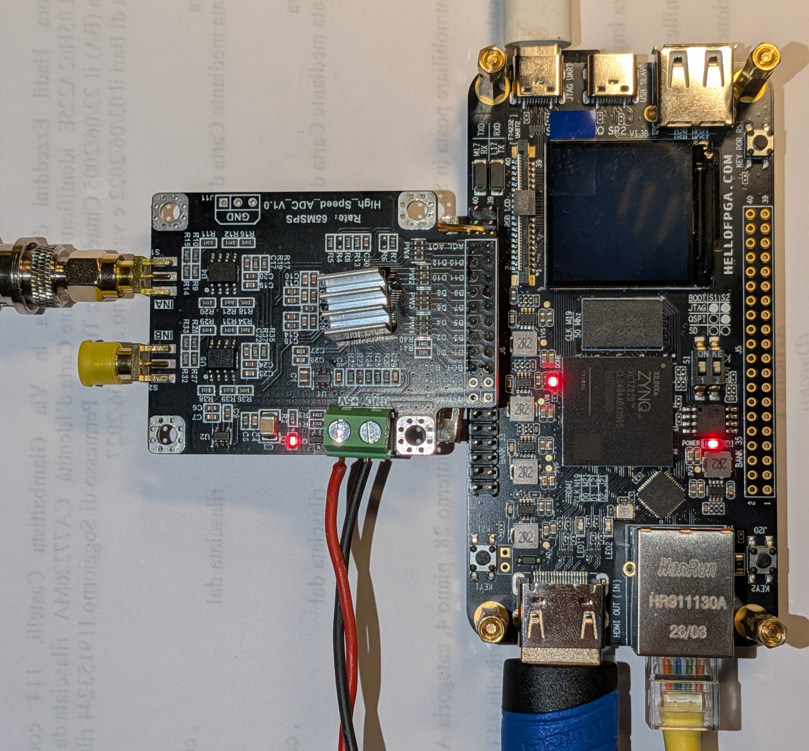
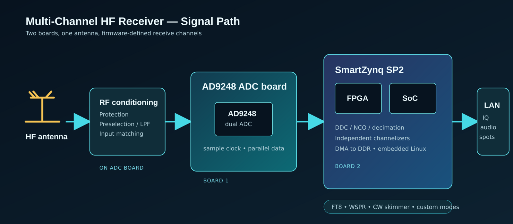
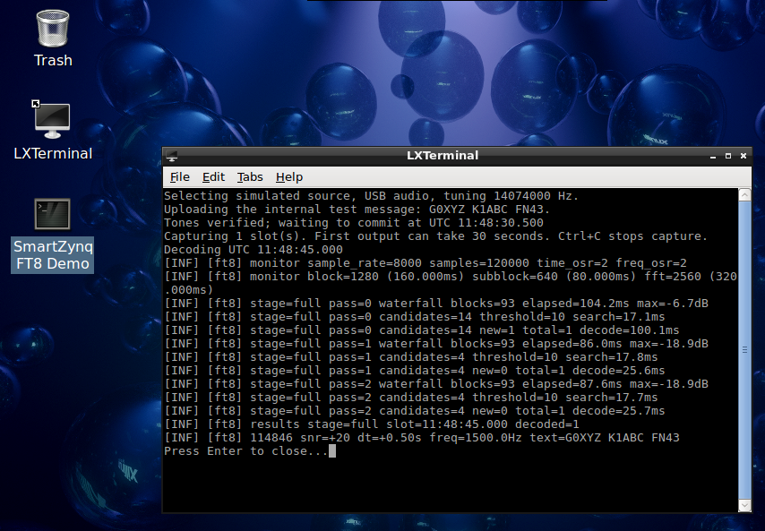

# SmartZynq SP2 HF receiver

## Overview

- This repository contains the programmable-logic designs for an HF receiver on the HelloFPGA SmartZynq SP2 V1.3B.
It retains the vendor Xillinux platform, including HDMI, Ethernet, SSH and Xillybus.
- The supported designs cover a vendor-compatible board test, ADC capture, and the HF SSB receiver.
- The ready-to-run SD image combines the tested PL boot files with the receiver software for an immediate demonstration.
- The companion [sz_hf_rx](https://github.com/guido57/sz_hf_rx) repository provides the A9 FT8 decoder and Linux utilities.


## Hardware

The receiver uses two readily available boards: 
- a HelloFPGA **SmartZynq SP2** for FPGA DSP, Linux control plane, HDMI display and Ethernet connection
- and an **AD9248-65** dual 14-bit ADC board, which is the acquisition front end

The FPGA generates the 64 MHz sampling clock and receives the ADC's parallel CMOS data through J6. It turns one digitized RF or IF stream into a tuned complex channel today; the longer-term architecture is to create several independent receive slices from that same sampled input.

Notes:
- The current receiver uses ADC channel A only; its B channel remains available for later work.
- The ADC board is not a complete HF front end by itself, it optionally needs: a suitable input protection, gain or attenuation and anti-alias filtering.



The individual boards and their assembly are documented here: https://hackaday.io/project/206722-hf-receiver-on-adc-and-fpga.

## Receiver architecture

The present implementation is one receiver channel but the production target is
at least four simultaneous receiver slices and four independent FT8 decoders.

The FPGA handles the high-rate conversion work, while Xillinux configures the receiver, presents the local monitor, and provides audio/IQ data over Ethernet.



## Ready-to-run receiver SD image

[Download boot-tested v3 (2026-11-08)](https://github.com/guido57/SmartZynq_SP2_HF_receiver/releases/tag/sd-image-v3-2026-11-08), verify its SHA-256 checksum, and flash the `.img.gz` to a spare SD card as described in the [first-use guide](https://github.com/guido57/sz_hf_rx/blob/main/docs/sd_image.md). Insert the card in the SmartZynq and power it on; HDMI/LXDE, SSH and VNC start automatically.

Find the board IP address from the router or the HDMI desktop. Connect with either `ssh root@BOARD_IP` (password `root`) or a VNC client to `BOARD_IP:5900` (password `root`). The image includes the receiver software and a desktop launcher named **SmartZynq FT8 Demo**.

For the simple internal FT8 demonstration:

- log in via ssh and run:

```bash
sz-hf-rx
```

or log in via VNC and dbl-click on "SmartZynq FT8 Demo".
You'll see something like this:




It configures the FPGA's internal FT8 source, uploads the test frame, aligns it to a 15-second FT8 slot, captures the stream, and runs the decoder. The expected message is `G0XYZ K1ABC FN43`. 

Just in case you want to build or customize an image, for operating details see:
- [image composition guide](docs/sd-image.md)  
- [software first-use guide](https://github.com/guido57/sz_hf_rx/blob/main/docs/sd_image.md) 

## Vivado projects

| Vivado Project | Purpose |
| :--- | :--- |
| [`board_test`](vivado/projects/board_test/) | Minimal vendor-compatible board and Xillinux test. |
| [`adc_simulator`](vivado/projects/adc_simulator/) | Simulated or external AD9248 capture path. |
| [`hf_ssb_receiver`](vivado/projects/hf_ssb_receiver/) | 64 MS/s DDC, sharp channel filter, USB/LSB demodulation, PCM audio and PS-controlled FT8 simulator. |

Each project has its own `create_project.tcl`, `open_block_design.tcl`, and `build.tcl`. Generated Vivado projects live below that project's `project/` directory and are ignored by Git.

## Documentation

- [PS–PL interface specification](docs/ps_pl_interface.md)
- [Documentation ownership and test records](docs/documentation-map.md)
- [Receiver operation (software repository)](https://github.com/guido57/sz_hf_rx/blob/main/docs/receiver.md)
- [Build, SD deployment and JTAG programming](docs/deployment.md)
- [Design and verification notes](docs/development.md)
- [JTAG reconfiguration lifecycle](docs/jtag-reconfiguration.md)
- [Project map](vivado/projects/README.md)

Earlier experimental projects, intermediate build notes and superseded guides are retained under [`archive/docs/`](archive/docs/). They are historical reference material, not instructions for the current three supported projects.
